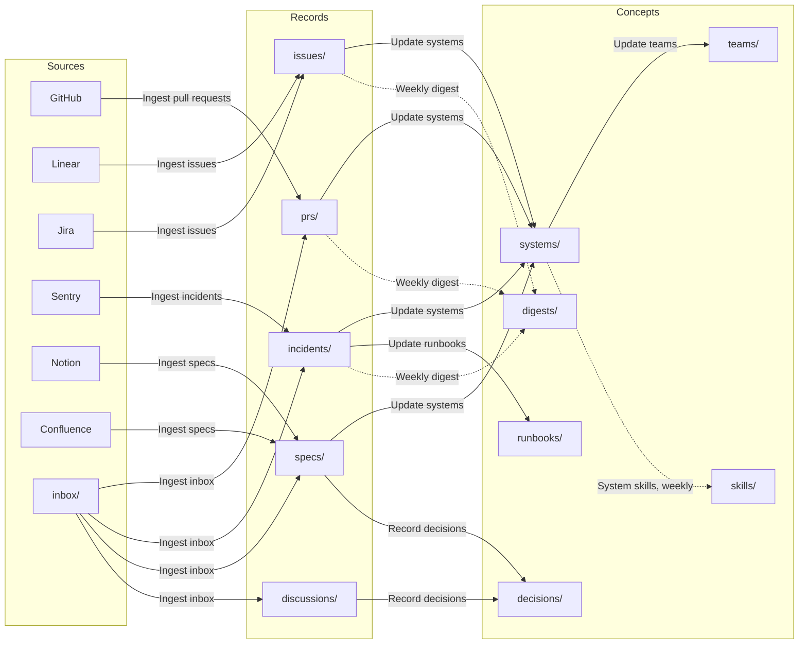

# Engineering docs

This repo keeps engineering docs current without anyone rewriting them by hand. Workflows read pull requests, issues, incidents, specs and chat threads, and keep one page per system, team, decision and runbook up to date, citing the records each page came from. Every change they make lands on a branch for review. When shipped code stops matching an approved spec, the System page says so. It starts with example data for Acme, a fictional shipping company, so you can see it work before connecting anything.

## How it works

Ingest workflows turn source events into records, one file per event. Refinement workflows read across records and keep the concept pages current. Every change a refinement makes lands on its own branch for review, and refinements run again only when that branch merges.



## Try it

Specs go stale the day after they're approved. Here's Update systems catching it, using the example data.

1. Open the Shipments API page, `systems/shipments-api.md`. Under Drift from spec it finds none against Cursor pagination for list shipments. Open its sources to see the spec and pull requests it compared.
2. On a new branch, add a file to `inbox/`, like `inbox/page-size.md`, with a pull request description that contradicts the spec:

   ```text
   Raise the list shipments page size limit to 500 (acme/shipments-api #561)

   Large accounts page through tens of thousands of shipments. GET /v1/shipments
   now accepts page sizes up to 500. The default stays at 50.
   ```

3. Ingest inbox writes a Pull Request record in `prs/` on your branch and moves the original to `archive/`.
4. Merge the branch. Update systems opens a branch where the Shipments API page has a new drift finding: the spec allows 200, the code now allows 500, citing both.
5. Merge that branch too. Update teams follows and lists the drift on the Shipping Core page, `teams/shipping-core.md`.
6. Now a service nobody has documented yet. On a new branch, add `inbox/address-check.md` with a pull request from a repository that has no System page:

   ```text
   Check addresses with the carrier before creating a shipment (acme/address-check #14)

   New service. Shipments API calls it before every create, and it asks the
   carrier whether the address is deliverable. Undeliverable addresses return
   a 422 with the carrier's suggestion.
   ```

7. Merge the branch. Update systems opens a branch with a new page, `systems/address-check.md`, marked `status: draft` and filled from that pull request. Review it, fix the name and owner, and remove `status: draft` before you merge.

## Connections

Workflows that read from other tools expect these connection names. Name your connections the same way, or edit the `connectors` and `on.connector` fields in `workflows/`. Without a connection, its ingest workflow never runs, and you can still drop material into `inbox/`.

Each connector trigger polls a read-only tool with the arguments under `on.with`. Change them to your organization, projects and spaces before you connect.

- `github`: Ingest pull requests from GitHub. Edit `org:acme` in the search query.
- `linear`: Ingest issues from Linear.
- `atlassian`: Ingest issues from Jira and Ingest specs from Confluence, through one connection. Edit `cloudId`, the project in the JQL, and label spec pages `spec`.
- `sentry`: Ingest incidents from Sentry. Edit `organizationSlug`.
- `notion`: Ingest specs from Notion. Set `data_source_url` to your specs database.

When you create a repo from this template, you choose one source per record type, so only one ingest workflow per type stays.

## Starting without example data

If you start empty, there's nothing to write by hand. Every record links to the system and team it belongs to, named after the source's own grouping: the GitHub repository, the Sentry project, a Linear `system:` label or team, a Jira component, a spec's Systems property. When a record names a system that has no page yet, Update systems creates one with `status: draft`, filled from the records. Update teams does the same for the teams that own those systems. Review the drafts on their branches, fix the names and owners, and remove `status: draft` when a page is right.

## Docs next to code

You can also keep these folders inside a code repository. Replace Ingest pull requests with a workflow triggered by `packages/**` that writes a Pull Request record for each merged change, and Update systems works the same way.

## Folders

Concepts, kept current by refinement workflows. Each has an `index.md` listing its pages.

- `systems/`: one page per system: owner, dependencies, recent changes, open issues, incidents and drift from spec.
- `teams/`: one page per team: what it owns and what needs attention.
- `decisions/`: one page per decision, with the options, the reasons and who decided.
- `runbooks/`: how to recognize and fix a known kind of problem, learned from incidents.
- `skills/`: agent skills on how to change each busy system safely, for Claude or Codex.
- `digests/`: one summary per week.

Records, one file per source event. Workflows never edit them after ingest.

- `prs/`: merged pull requests.
- `issues/`: issues from Linear or Jira.
- `incidents/`: resolved incidents from Sentry.
- `specs/`: PRDs, RFCs and technical designs.
- `discussions/`: chat threads where decisions were made.

Everything else:

- `inbox/`: drop pasted text or files here. Ingest inbox sorts them into records and moves the originals to `archive/`.
- `archive/`: inbox items that have been processed.
- `types/`: one definition per type, with the fields it uses.
- `workflows/`: the workflows that keep this repo current.
- `index.md`: a map of every folder. Each concept folder has its own `index.md` listing its pages.
- `log.md`: one line per workflow run, newest first.
