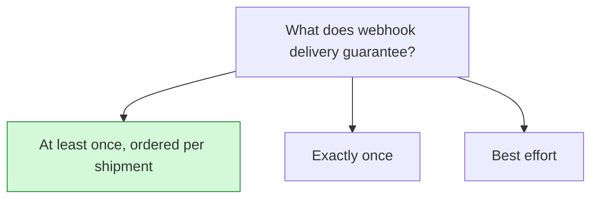

## Decision

Webhooks are delivered at least once, events for one shipment arrive in the order they happened, failed deliveries are retried up to 8 times over 24 hours, and every payload is signed.[^specs-mock-2]

## Options considered

- **At least once, ordered per shipment** (chosen): retried up to 8 times over 24 hours, signed over the exact bytes sent.
- **Exactly once**: the spec doesn't weigh it.
- **Best effort**: the spec doesn't weigh it.

## Reasons

- Customers build shipment timelines from these events and verify every payload, and both break if delivery reorders or re-encodes.[^specs-mock-2]

## Consequences

- Delivery has to keep order within a shipment, which limits how it can run in parallel.
- Customers must handle a repeated event.

## Who decided

Tomás Silva, on 2 October 2026.
