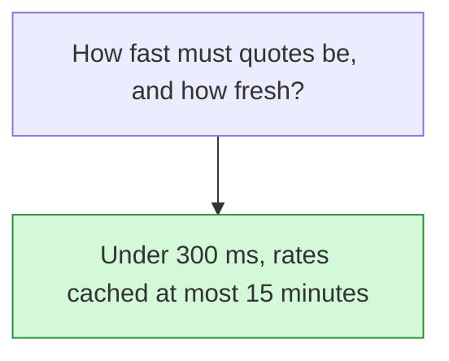

## Decision

Quotes stay under 300 ms at p95, including multi-parcel shipments. Cached carrier rates expire after 15 minutes, and a cached rate is never quoted after a carrier announces a price change.[^specs-mock-3]

## Options considered

- **Under 300 ms, rates cached at most 15 minutes** (chosen): never quote a rate after a carrier announces a price change. The PRD names no other option.

## Reasons

- Checkout pages call for rates on every keystroke in the address form, and slow quotes cost customers sales.[^specs-mock-3]

## Consequences

- The Rates Engine needs a cache and batched carrier calls to hit 300 ms.
- A later decision raised the cache time to 60 minutes. See [Cache carrier rates for an hour](2026-10-27-cache-carrier-rates-for-an-hour.md).

## Who decided

Ana Kovac, on 6 October 2026.
