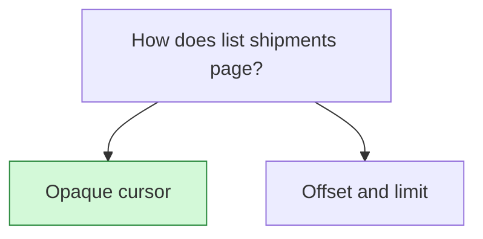

## Decision

GET /v1/shipments pages with an opaque cursor. The default page size is 50, the maximum is 200, and filters from the first request apply to every page.[^specs-mock-6]

## Options considered

- **Opaque cursor** (chosen): default page size 50, maximum 200, filters apply to every page.
- **Offset and limit**: keeps working until v1 is retired.

## Reasons

- The design gives no reasons beyond the requirements themselves.[^specs-mock-6]

## Consequences

- Offset pagination stays until v1 is retired.[^specs-mock-6]

## Who decided

Lena Ito, on 9 October 2026.
