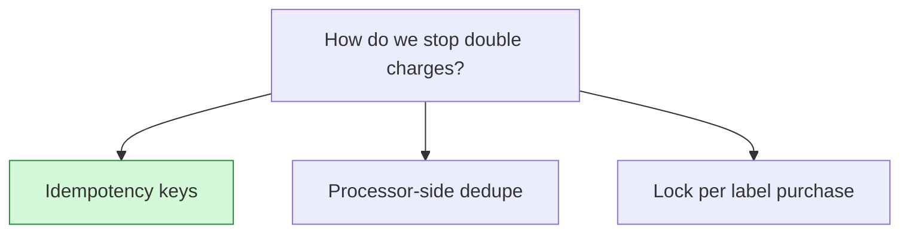

## Decision

Every charge carries an idempotency key built from the label purchase ID, retries reuse it, and the ledger refuses a second entry for the same key.[^discussions-mock-1][^specs-mock-1]

## Options considered

- **Idempotency keys** (chosen): on every charge, reused on retries, and stored in the ledger.
- **Processor-side dedupe**: needs a contract change with the processor.
- **Lock per label purchase**: doesn't help when the processor's retry and ours race.

## Reasons

- The processor already supports idempotency keys, while its own dedupe would need a contract change.[^discussions-mock-1]
- A lock on our side doesn't stop the processor's retry racing ours.[^discussions-mock-1]
- Keys in the ledger mean it refuses a second entry even if billing slips.[^discussions-mock-1]

## Consequences

- Retries are safe at the processor and in the ledger.
- The RFC also caps retries at 5 with exponential backoff.[^specs-mock-1]

## Who decided

Maya Chen, Dev Okafor and Ana Kovac, on 12 October 2026.
