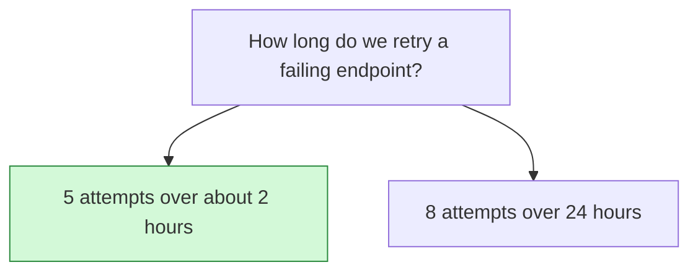

## Decision

A failed delivery is retried 5 times over about 2 hours, then shown as failed.[^discussions-mock-4]

## Options considered

- **5 attempts over about 2 hours** (chosen): then the delivery shows as failed.
- **8 attempts over 24 hours**: what the delivery guarantees spec requires.[^specs-mock-2]

## Reasons

- Endpoints that are down for a day keep 8 retries each in the queue and fill it.[^discussions-mock-4]

## Consequences

- This contradicts Webhook delivery guarantees, which still says 8 retries over 24 hours. Tomás said he would update it.[^discussions-mock-4][^specs-mock-2]
- Customers whose endpoint is down for more than 2 hours lose those events unless they resend them.

## Who decided

Jonah Park and Tomás Silva, on 17 October 2026.
