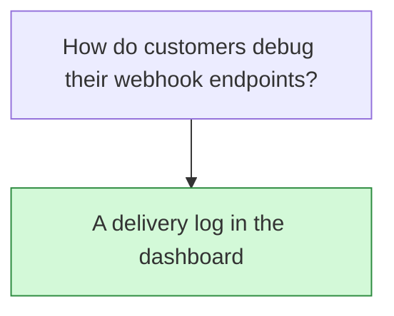

## Decision

The dashboard shows every delivery attempt from the last 30 days, filters them by status and event type, and resends a failed event with one click.[^specs-mock-5]

## Options considered

- **A delivery log in the dashboard** (chosen): 30 days of attempts, filters by status and event type, one-click resend. The PRD names no other option.

## Reasons

- Customers should fix their own endpoints without writing to support.[^specs-mock-5]

## Consequences

- A later decision launched it with 7 days and a status filter first. See [Launch the delivery log with 7 days](2026-10-30-launch-the-delivery-log-with-7-days.md).

## Who decided

Priya Raman, on 20 October 2026.
