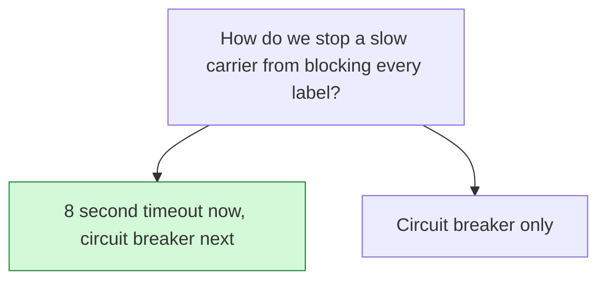

## Decision

Carrier label calls time out after 8 seconds and return a retryable error. A circuit breaker follows.[^discussions-mock-8]

## Options considered

- **8 second timeout now, circuit breaker next** (chosen): the timeout ships the same day.
- **Circuit breaker only**: takes longer to build.

## Reasons

- Label calls had no timeout, so every worker was stuck on one carrier.[^discussions-mock-8]
- Carrier p99 is about 3 seconds, so 8 seconds leaves room.[^discussions-mock-8]

## Consequences

- One slow carrier no longer holds every worker, but its purchases still fail until someone switches carriers.

## Who decided

Lena Ito, Ravi Menon and Jonah Park, on 24 October 2026.
