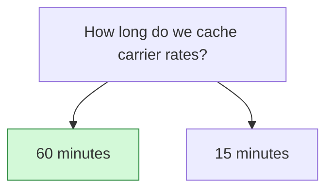

## Decision

Carrier rates are cached for 60 minutes. Price-change notices still clear the cache right away.[^discussions-mock-3]

## Options considered

- **60 minutes** (chosen): about 70 percent fewer carrier calls. Watch quote accuracy for two weeks.
- **15 minutes**: what Rate quotes under 300 ms requires.[^specs-mock-3]

## Reasons

- Carrier rate calls are the team's second largest infra cost, and an hour cuts them by about 70 percent.[^discussions-mock-3]
- Price-change notices still clear the cache, so the risk is only rate updates carriers don't announce.[^discussions-mock-3]

## Consequences

- This contradicts Rate quotes under 300 ms, which still says 15 minutes. Ana will update it after two weeks of numbers.[^discussions-mock-3][^specs-mock-3]

## Who decided

Lena Ito, Ravi Menon and Ana Kovac, on 27 October 2026.
