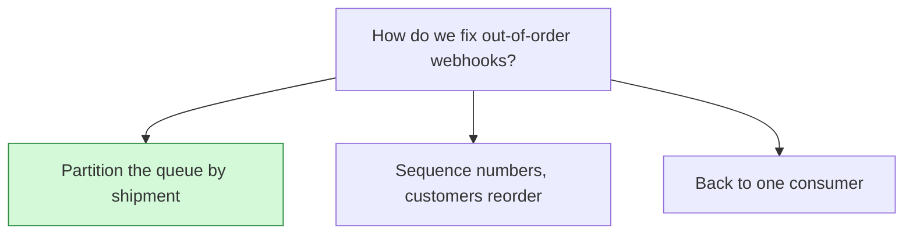

## Decision

The delivery queue is partitioned by shipment ID, and one worker consumes each partition in order.[^discussions-mock-2]

## Options considered

- **Partition the queue by shipment** (chosen): ordered within a shipment, parallel across shipments.
- **Sequence numbers, customers reorder**: pushes the work onto every customer.
- **Back to one consumer**: brings back the 14 October backlog.

## Reasons

- Sequence numbers push the work onto every customer.[^discussions-mock-2]
- One consumer can't keep up with bursts.[^discussions-mock-2]
- Per-shipment order also makes the dashboard delivery log easier.[^discussions-mock-2]

## Consequences

- Delivery keeps the order the delivery guarantees spec requires.

## Who decided

Tomás Silva, Jonah Park and Priya Raman, on 28 October 2026.
