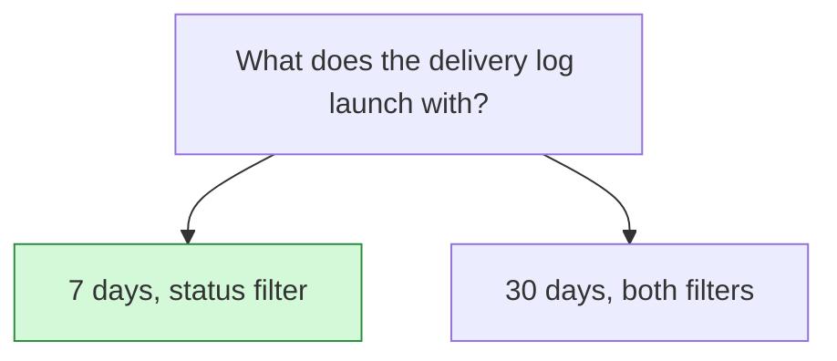

## Decision

The delivery log launches with 7 days of attempts and a status filter. It goes to 30 days, with an event type filter, after webhook delivery is partitioned.[^discussions-mock-6]

## Options considered

- **7 days, status filter** (chosen): the query takes under a second.
- **30 days, both filters**: the query takes 9 seconds for big accounts.

## Reasons

- Querying 30 days takes 9 seconds for big accounts, 7 days under one.[^discussions-mock-6]
- Partitioning lets attempts be indexed by shipment, which should make 30 days fast.[^discussions-mock-6]

## Consequences

- The dashboard falls short of the delivery log PRD until the follow-up ships. See [Show a webhook delivery log in the dashboard](2026-10-20-webhook-delivery-log-in-the-dashboard.md).

## Who decided

Priya Raman, Sofia Lund and Jonah Park, on 30 October 2026.
