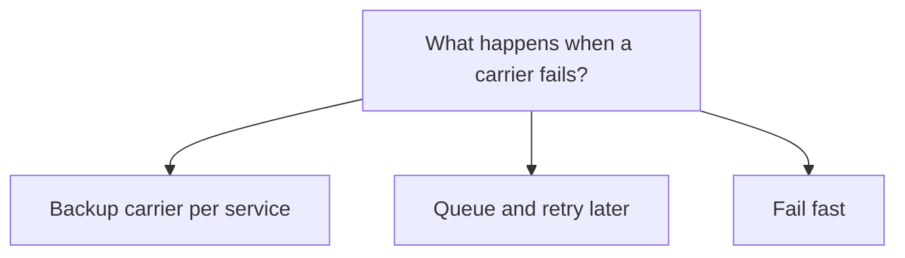

## Decision

Not decided. Lena proposes a backup carrier per service, used automatically when the circuit breaker opens. The RFC stays in review until pricing is answered.[^discussions-mock-5][^specs-mock-4]

## Options considered

- **Backup carrier per service**: Lena's proposal, used automatically when the circuit breaker opens.
- **Queue and retry later**: simpler, but customers want a label now.
- **Fail fast**: the customer picks another service.

## Reasons

- Twice in two weeks someone had to set the carrier override by hand.[^specs-mock-4]
- Customers want a label now, not a queued purchase.[^discussions-mock-5]

## Consequences

- Billing needs to know who pays when the backup carrier costs more.[^discussions-mock-5]

## Who decided

Lena Ito, on 3 November 2026. Nothing is agreed yet.
