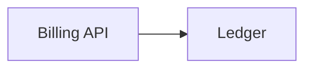

The Billing API charges customers for every label they buy and retries charges that fail. Label Service calls it on each purchase, and the Customer Dashboard reads charges from it for the billing page.

## Owner and dependencies

Owned by [Payments](/teams/payments.md).



## Recent changes

- Failed charges keep the processor's response code and message, so support can tell a declined card from a processor error.[^prs-mock-16]
- Failed charges are retried 3 times, 10 seconds apart, then marked failed.[^prs-mock-2]
- Every charge carries an idempotency key built from the label purchase ID, so a retry can't charge twice.[^prs-mock-1]

## Open issues

- Invoice PDFs show charge times in UTC (ENG-231, low).[^issues-mock-3]

## Incidents

- 2 October: fourteen accounts were charged twice for one label after processor timeouts. See [Duplicate charges](/runbooks/duplicate-charges.md).[^incidents-mock-1]

## Drift from spec

- Idempotent charges requires at most 5 retries with exponential backoff starting at 2 seconds. Retries now stop after 3 attempts, 10 seconds apart.[^specs-mock-1][^prs-mock-2]

## Activity

```vega-lite
{
  "$schema": "https://vega.github.io/schema/vega-lite/v5.json",
  "description": "Issues opened per week: Billing API",
  "data": {
    "values": [
      { "week": "2026-09-28", "issues": 1 },
      { "week": "2026-10-05", "issues": 0 },
      { "week": "2026-10-12", "issues": 0 },
      { "week": "2026-10-19", "issues": 0 },
      { "week": "2026-10-26", "issues": 0 },
      { "week": "2026-11-02", "issues": 1 }
    ]
  },
  "mark": "bar",
  "encoding": {
    "x": { "field": "week", "type": "ordinal", "title": "Week of" },
    "y": {
      "field": "issues",
      "type": "quantitative",
      "title": "Issues opened",
      "axis": {
        "tickMinStep": 1
      }
    }
  }
}
```
