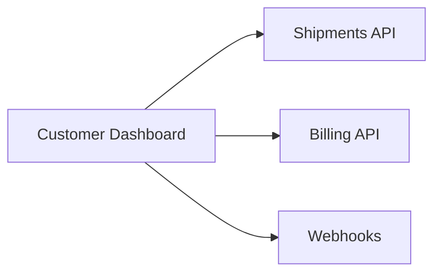

The Customer Dashboard is the web app where customers manage shipments, billing and webhook settings. It reads from the Shipments API, the Billing API and Webhooks.

## Owner and dependencies

Owned by [Web](/teams/web.md).



## Recent changes

- The webhook settings page lists delivery attempts from the last 7 days, filters them by status, and resends a failed event.[^prs-mock-12]

## Open issues

- Billing page times out for accounts with many labels (ENG-240, high).[^issues-mock-9]

## Incidents

- 7 October: some customers were sent back to the login page after signing in, for 40 minutes. The cause is unknown.[^incidents-mock-7]

## Drift from spec

- Webhook delivery log in the dashboard requires 30 days of delivery attempts. The settings page shows the last 7 days.[^specs-mock-5][^prs-mock-12]
- It also requires a filter by event type. The page filters by status only.[^specs-mock-5][^prs-mock-12]

## Activity

```vega-lite
{
  "$schema": "https://vega.github.io/schema/vega-lite/v5.json",
  "description": "Issues opened per week: Customer Dashboard",
  "data": {
    "values": [
      { "week": "2026-09-28", "issues": 0 },
      { "week": "2026-10-05", "issues": 0 },
      { "week": "2026-10-12", "issues": 0 },
      { "week": "2026-10-19", "issues": 1 },
      { "week": "2026-10-26", "issues": 0 },
      { "week": "2026-11-02", "issues": 1 }
    ]
  },
  "mark": "bar",
  "encoding": {
    "x": { "field": "week", "type": "ordinal", "title": "Week of" },
    "y": {
      "field": "issues",
      "type": "quantitative",
      "title": "Issues opened",
      "axis": {
        "tickMinStep": 1
      }
    }
  }
}
```
