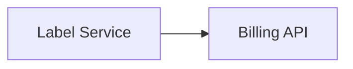

Label Service buys shipping labels from carriers and renders them, and charges each purchase through the Billing API. When it fails, customers can't ship.

## Owner and dependencies

Owned by [Shipping Core](/teams/shipping-core.md).



## Recent changes

- Carrier label calls time out after 8 seconds and return a retryable error, so one slow carrier can't hold every worker.[^prs-mock-9]

## Open issues

- Add a circuit breaker for carrier label calls (ENG-233, high).[^issues-mock-6]

## Incidents

- 4 November: purchases for one carrier failed for 35 minutes during its outage, until someone set the carrier override.[^incidents-mock-4]
- 24 October: most purchases failed for 50 minutes while a carrier's label API hung. See [Carrier API timeouts](/runbooks/carrier-api-timeouts.md).[^incidents-mock-3]

## Drift from spec

- No approved spec lists this system. Carrier failover for labels is still in review.[^specs-mock-4]

## Activity

```vega-lite
{
  "$schema": "https://vega.github.io/schema/vega-lite/v5.json",
  "description": "Issues opened per week: Label Service",
  "data": {
    "values": [
      { "week": "2026-09-28", "issues": 0 },
      { "week": "2026-10-05", "issues": 0 },
      { "week": "2026-10-12", "issues": 0 },
      { "week": "2026-10-19", "issues": 1 },
      { "week": "2026-10-26", "issues": 0 },
      { "week": "2026-11-02", "issues": 0 }
    ]
  },
  "mark": "bar",
  "encoding": {
    "x": { "field": "week", "type": "ordinal", "title": "Week of" },
    "y": {
      "field": "issues",
      "type": "quantitative",
      "title": "Issues opened",
      "axis": {
        "tickMinStep": 1
      }
    }
  }
}
```
