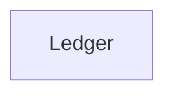

The Ledger is the double-entry record of every balance change and charge at Acme. The Billing API writes an entry for each successful charge, and finance reads balances from it.

## Owner and dependencies

Owned by [Payments](/teams/payments.md). It depends on no other Acme system.



## Recent changes

- A second entry with the same idempotency key is rejected, and the first entry is returned, so callers can retry safely.[^prs-mock-3]

## Open issues

None.

## Incidents

None in the last 90 days.

## Drift from spec

No approved spec lists this system.

## Activity

```vega-lite
{
  "$schema": "https://vega.github.io/schema/vega-lite/v5.json",
  "description": "Issues opened per week: Ledger",
  "data": {
    "values": [
      { "week": "2026-08-31", "issues": 0 },
      { "week": "2026-09-07", "issues": 0 },
      { "week": "2026-09-14", "issues": 0 },
      { "week": "2026-09-21", "issues": 0 },
      { "week": "2026-09-28", "issues": 1 },
      { "week": "2026-10-05", "issues": 0 }
    ]
  },
  "mark": "bar",
  "encoding": {
    "x": { "field": "week", "type": "ordinal", "title": "Week of" },
    "y": {
      "field": "issues",
      "type": "quantitative",
      "title": "Issues opened",
      "axis": {
        "tickMinStep": 1
      }
    }
  }
}
```
