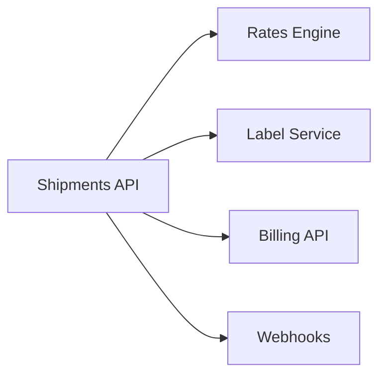

The Shipments API is Acme's public API to create, list and track shipments. It calls the Rates Engine for quotes, Label Service for labels, and the Billing API for charges, and hands events to Webhooks.

## Owner and dependencies

Owned by [Shipping Core](/teams/shipping-core.md).



## Recent changes

- List shipments pages with an opaque cursor, 50 per page by default and 200 at most.[^prs-mock-14]
- Addresses without a postal code are accepted where countries don't use them, and a missing required one returns a 422 naming the field.[^prs-mock-13]

## Open issues

- List shipments ignores the status filter after the first page (ENG-238, medium).[^issues-mock-11]

## Incidents

- 2 November: a third of shipment creates failed for 20 minutes after a migration added a required column with no default. See [Failed migrations](/runbooks/failed-migrations.md).[^incidents-mock-6]

## Drift from spec

- No drift found against Cursor pagination for list shipments.[^specs-mock-6]

## Activity

```vega-lite
{
  "$schema": "https://vega.github.io/schema/vega-lite/v5.json",
  "description": "Issues opened per week: Shipments API",
  "data": {
    "values": [
      { "week": "2026-09-28", "issues": 0 },
      { "week": "2026-10-05", "issues": 1 },
      { "week": "2026-10-12", "issues": 0 },
      { "week": "2026-10-19", "issues": 0 },
      { "week": "2026-10-26", "issues": 0 },
      { "week": "2026-11-02", "issues": 1 }
    ]
  },
  "mark": "bar",
  "encoding": {
    "x": { "field": "week", "type": "ordinal", "title": "Week of" },
    "y": {
      "field": "issues",
      "type": "quantitative",
      "title": "Issues opened",
      "axis": {
        "tickMinStep": 1
      }
    }
  }
}
```
