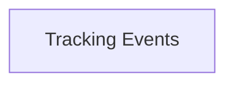

Tracking Events polls carrier feeds and turns their updates into shipment timelines. Webhooks sends those updates on to customers.

## Owner and dependencies

Owned by [Platform](/teams/platform.md). It depends on no other Acme system.



## Recent changes

- Raw carrier events are stored for 14 days before parsing, so dropped updates can be replayed.[^prs-mock-11]
- A poller that hits an auth error refreshes its token and restarts instead of retrying forever.[^prs-mock-10]

## Open issues

- Alert when a carrier feed stops sending updates (ENG-235, medium).[^issues-mock-7]

## Incidents

- 30 October: one carrier's updates were two hours late because its poller kept retrying an expired token. See [Stalled carrier feeds](/runbooks/stalled-carrier-feeds.md).[^incidents-mock-5]

## Drift from spec

No approved spec lists this system.

## Activity

```vega-lite
{
  "$schema": "https://vega.github.io/schema/vega-lite/v5.json",
  "description": "Issues opened per week: Tracking Events",
  "data": {
    "values": [
      { "week": "2026-09-28", "issues": 0 },
      { "week": "2026-10-05", "issues": 0 },
      { "week": "2026-10-12", "issues": 0 },
      { "week": "2026-10-19", "issues": 0 },
      { "week": "2026-10-26", "issues": 1 },
      { "week": "2026-11-02", "issues": 0 }
    ]
  },
  "mark": "bar",
  "encoding": {
    "x": { "field": "week", "type": "ordinal", "title": "Week of" },
    "y": {
      "field": "issues",
      "type": "quantitative",
      "title": "Issues opened",
      "axis": {
        "tickMinStep": 1
      }
    }
  }
}
```
